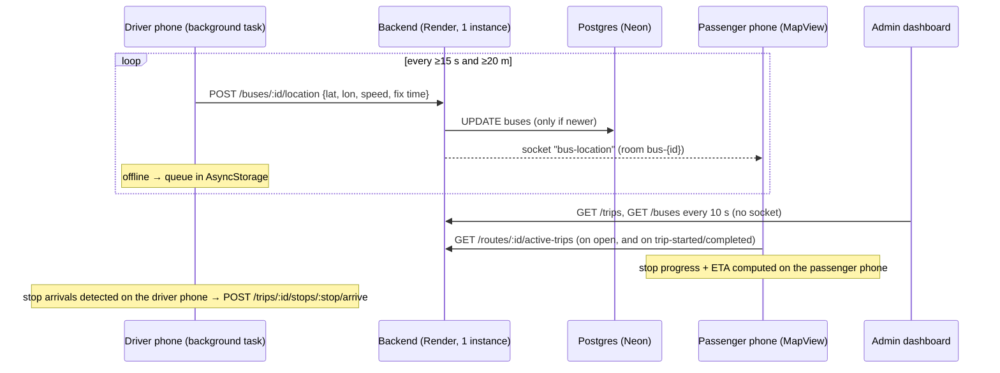
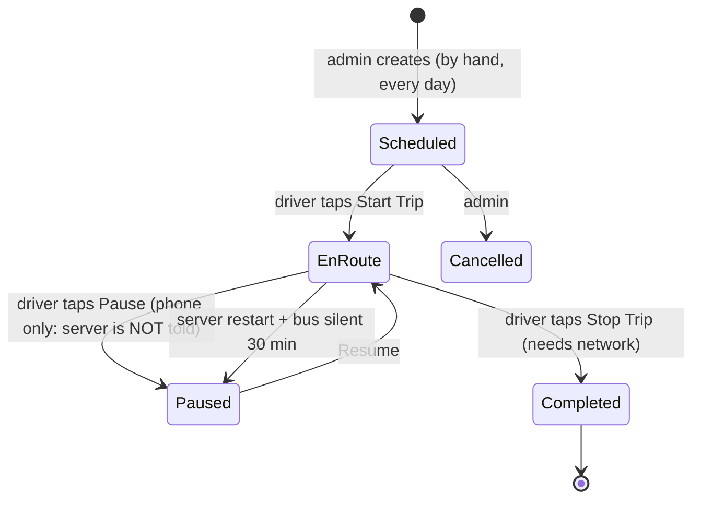

# MY(suru) BUS — Implementation Audit (2026-11-24)

The [code audit](AUDIT_2026-11.md) asked "is each piece of code correct?". This one asks **"does the system work for real people on a real day?"**: it follows the admin, the driver and the passenger through their journeys, traces where each piece of data goes, and checks what happens when phones, networks and servers misbehave.

**Method.** Read every step of each journey in the code (after the second code-audit pass, uncommitted at the time of writing), ran the stack locally with seeded data, and measured the ETA and stop-detection logic against the seeded routes. Numbers below come from those measurements.

## Status (2026-11-24, later the same day)

Priorities **1–6 below are implemented** (uncommitted at the time of writing). They were checked with 67 backend tests (`journeys.test.ts` covers stop passing, ETAs, daily trips and session renewal), a simulated trip against a real database, and the dashboard in a browser:

- **Driver home** shows a running or paused trip first ("Continue Trip" / "Resume Trip").
- **Daily trips**: schedules have days of the week plus a default bus and driver (migration `004`). The server creates today's and tomorrow's trips on startup and every 30 minutes; it's idempotent. The dashboard's **Generate Today's Trips** button works and names schedules that lack a default bus or driver.
- **Server-side progress**: every accepted position advances the trip's last passed stop (inside the circle = measured; clearly beyond it = `inferred`). The server publishes `trip-progress` to the trip, bus and route rooms, and `GET /api/trips/:id/progress` is public. Both apps render this; the on-phone stop detection in the passenger app is gone.
- **ETAs** = scheduled time + current delay, never in the past. The passenger route screen now actually shows live data: bus picker, stop progress, "Expected 13:24" / "On time", and "Running 7 min late".
- **Silence is visible**: Pause/Resume go to the server; paused trips stay listed as paused. Passengers see "Live · updated just now", "Updated 3 min ago" or "No signal for 6 min". Live Monitoring shows the same.
- **Driver sessions** last 7 days and renew while in use (`X-Refreshed-Token`). If the session ends while the app is in the background, the driver gets a "Bus location sharing stopped" notification. The app asks once for the battery-optimisation exemption.

Still open: priorities 7–9 (map tiles, hosting and caching, position history).

## Verdict

The pieces exist and the live-location pipe (phone → server → passenger socket) is sound. But four things stop a real depot from running on it tomorrow:

1. **Nobody creates tomorrow's trips.** There is no automatic daily trip generation; the dashboard's "Generate Today's Trips" button is a stub. If an admin forgets one morning, no driver can start and no passenger sees a bus.
2. **Trip progress is computed on each phone, from scratch, and gets stuck.** The driver's stop list never advances, and a passenger who opens the map mid-trip sees the bus stuck at stop 1 for the rest of the trip.
3. **ETAs are 2–4× too optimistic.** They use straight-line distance at 50 km/h; the schedules imply 10–31 km/h.
4. **A driver can silently stop broadcasting** (expired 24 h login, local-only pause, battery saver), and passengers get no hint that the bus on their map is frozen.

None of these needs a rewrite. The [recommended design](#recommended-design) section moves trip state and ETAs to the server, which fixes 2–4 at once.

---

## How data flows today

### Live location

What's stored: **only the latest position per bus** (`buses.current_*`). There is no position history, so a trip can't be replayed, delays can't be learned, and a dispute ("the bus never came") can't be checked.

### Trip lifecycle

---

## Journey 1 — Admin: setting up and running a day

| Step | What happens | Real-world problem | Severity |
|---|---|---|---|
| Create stops | Click on a map; default geofence **50 m** | A pin 20–30 m off the carriageway plus a 50 m radius makes automatic arrival detection miss stops (see [measurements](#measurements)) | Medium |
| Create route + stops | Ordered stop list with time offsets | Fine. Routes are one-directional: the return journey is a separate route with its own stops and schedules | Low |
| Schedules | Route + start time | No days of the week, holidays or validity period. Every schedule runs every day | Medium |
| **Create the day's trips** | Trips page → "Add Trip": pick a route, bus, driver and date; creates one trip **per schedule of that route**, all on the same bus and driver | **Must be repeated every day for every route.** "Generate Today's Trips" just shows *"not yet implemented in API"*, although `POST /trips/reset-daily` exists. `reset-daily` copies *yesterday*, so it breaks after any day without trips. | **Critical** |
| Hand credentials to drivers | Fixed in the code audit: one-time login details and a Reset password action | — | — |
| Watch the fleet | Live Monitoring polls every 10 s | No alert when a trip should have started but hasn't, or when a bus goes silent. The admin has to notice | Medium |
| Passenger reports | List with status | No notification to the admin; reports sit until someone opens the page | Low |

## Journey 2 — Driver: a working day

| Step | What happens | Real-world problem | Severity |
|---|---|---|---|
| Sign in | Phone + password; token valid **24 h** | A driver who signs in at 05:30 Monday is signed out at 05:30 Tuesday, mid-shift. The background task then gets 401 on every location update, clears the token and quietly stops broadcasting; the driver sees nothing until they open the app | **High** |
| Home screen | Shows the next trip with status `Scheduled` or `'In Progress'` | **`'In Progress'` doesn't exist; the live status is `En Route`.** After the app is killed or the phone restarts mid-trip, the running trip disappears from Home and the driver can't get back to it (the "Continue Trip" button is unreachable code). Paused trips vanish too | **High** |
| Start Trip | Opens the trip screen, sets `En Route`, starts background tracking (foreground service notification) | No guard against starting the wrong trip early (e.g. the 17:30 run at 06:00). Background location on aggressive Android skins (Xiaomi, Infinix, Oppo…) is often killed unless the app is exempted from battery optimisation, and nothing asks the driver to do that | Medium |
| During the trip | Stop list and "next stop" ETA on screen | **The stop list never advances.** `handleStopArrival` is never called, and the screen never reads the arrivals the background task records. The driver sees stop 1 as "next" for the whole trip | **High** |
| Arrival detection | Background task: a stop counts when a GPS sample lands inside its circle; samples arrive every ≥15 s | Reliable when the bus actually stops. Stops the bus skips (nobody waiting) are often missed at 50 m radius (up to 40–52 % at 40 km/h), and a missed stop is never recorded | Medium |
| Pause | Stops GPS on the phone only | The server still says `En Route`; passengers see a frozen bus with no explanation | Medium |
| Stop Trip | `PATCH /status Completed`, then stop tracking | Needs the network. Offline, it shows an error and tracking keeps running | Medium |
| New-trip notifications | `setInterval` every 30 s | Only while the app is open; no real push | Low |

## Journey 3 — Passenger: catching a bus

| Step | What happens | Real-world problem | Severity |
|---|---|---|---|
| Search | Autocomplete from all stops (substring), then server search for **direct** routes between two stops | No typo tolerance or aliases ("K R Circle", "KR Circle", Kannada names); the trigram index exists but isn't used for similarity. No transfers | Medium |
| Route page → map | Loads route, stops and active trips; joins socket rooms; updates live | Sound. On reconnect it re-joins rooms but doesn't refetch, so it can show a missed position for up to 15 s | Low |
| **Stop progress** | Computed on the passenger phone from the **first bus only**, checking only the next stop in order, starting at stop 1 **each time the screen opens** | Opening the map mid-trip (the normal case) leaves the bus "before stop 1" forever, because it never passes stop 1 again. With two buses on a route, the second bus is ignored | **Critical** |
| **ETA** | Straight-line distance ÷ current speed, or **50 km/h** when the bus is stopped; computed for every stop, including ones already passed | 2–4× too optimistic (see [measurements](#measurements)); a bus stuck at a signal shows as "arriving". Scheduled times never show because `tripStartTime` is never passed, and the offsets arrive as text (`"00:10:00"`) | **Critical** |
| Freshness | Bus marker shows its last position | No "last seen" time. A bus whose driver lost signal 20 minutes ago looks live | **High** |
| Report a problem | Pick a running bus, category, message | Fixed in the code audit (public active-trip list, keyboard, empty state) | — |
| Announcements | Read on demand | No push; the socket listener is a TODO | Low |

---

## Reliability and infrastructure

| Component | Today | Failure mode | Impact |
|---|---|---|---|
| Backend | Render **free**, one instance | Sleeps after 15 min idle; first request took **18.6 s** when measured. The keep-alive is a GitHub cron, which GitHub delays or skips under load and disables after 60 days of repo inactivity | The first passenger of the morning waits ~20 s; drivers' first updates time out (10 s) and get queued |
| Rate limiting | In memory, **per IP**, 100 req/min (10 for logins) | Indian mobile carriers put many users behind one public IP (carrier-grade NAT). At a busy stop many passengers share one counter | Real users get "Too many requests" at peak |
| Live updates | Socket.io on that one instance | Fine at this scale; no fan-out across instances (needs a Redis adapter if ever scaled) | — |
| Map tiles | Straight from `tile.openstreetmap.org` in all three apps, plus Leaflet itself from `unpkg.com` at runtime inside the app WebViews | OSM's tile policy forbids heavy app use and requires an identifying Referer/User-Agent, which an inline WebView page doesn't send. Tiles can be throttled or blocked, and a CDN hiccup breaks maps entirely | Blank maps in production |
| Road routing | Public OSRM **demo** server, called on every map open (admin pages, passenger route map) | Demo server: no SLA, about 1 request/s fair use | Route lines fail at the worst time |
| Database | Neon free | Scale-to-zero adds ~0.5–1 s to the first query after idle | Minor |
| Sessions | Stateless JWT, 24 h, no refresh | See Driver: sign in | Silent tracking loss |
| History | Latest position only | No replay, no delay learning, no evidence for complaints | Product limitation |

---

## Measurements

### Schedules vs the app's ETA

Straight-line distance between consecutive stops on the seeded routes, the time the schedule allows, and what the app's ETA formula says when the bus is stopped (50 km/h):

| Route | Leg | Distance | Scheduled | Implied speed | App ETA |
|---|---|---|---|---|---|
| 1A | City Bus Stand → KR Circle | 1,995 m | 10 min | 12.0 km/h | 2.4 min |
| 1A | KR Circle → University of Mysore | 4,651 m | 15 min | 18.6 km/h | 5.6 min |
| 1A | University → Vijayanagar 4th Stage | 4,164 m | 15 min | 16.7 km/h | 5.0 min |
| 1A | Vijayanagar → Infosys | 4,568 m | 15 min | 18.3 km/h | 5.5 min |
| 2B | Railway Station → KR Circle | 2,057 m | 12 min | 10.3 km/h | 2.5 min |
| 2B | KR Circle → Palace | 2,000 m | 8 min | 15.0 km/h | 2.4 min |
| 3C | Hebbal Circle → Bannimantap | 4,189 m | 8 min | 31.4 km/h | 5.0 min |
| 3C | Bannimantap → City Bus Stand | 4,641 m | 10 min | 27.8 km/h | 5.6 min |
| 3C | City Bus Stand → Chamundi Hill Base | 3,870 m | 17 min | 13.7 km/h | 4.6 min |

From the start of route 1A to Infosys the schedule allows **55 min**; the app would tell a waiting passenger about **19 min**.

### Automatic stop detection

Chance that a bus driving past a stop **without stopping** produces no GPS sample inside the stop's circle (one sample per ≥15 s):

| Radius | Pin off the road | 25 km/h | 40 km/h |
|---|---|---|---|
| 50 m (dashboard default) | 0 m | 4 % | 40 % |
| 50 m | 30 m | 23 % | 52 % |
| 75 m | 0 m | 0 % | 10 % |
| 75 m | 30 m | 0 % | 18 % |
| 100 m (seeded stops) | any up to 30 m | 0 % | 0 % |

Buses that actually stop are detected reliably; the risk is skipped stops and admin-created stops left at 50 m.

---

## Recommended design

The common thread: **phones should report facts (positions); the server should decide what they mean (progress, delay, ETA) and everyone should show the server's answer.** That removes three separate implementations that disagree today (driver screen, driver background task, passenger screen).

1. **Server-side trip progress.** On each position update, the backend advances the trip's "last passed stop" monotonically: a stop counts as passed when the bus came within the radius **or** is now closer to a later stop along the route. It writes `trip_stop_times` and emits one `trip-progress` event `{trip_id, last_stop_seq, delay_min, updated_at}` to the trip, bus and route rooms. Both apps render that. This fixes the stuck stop list, the passenger "stuck at stop 1", multi-bus routes, and missed skipped stops.
2. **Schedule-based ETAs.** `ETA(stop) = trip start + offset(stop) + current delay`, where delay = actual minus scheduled time at the last passed stop. All the data already exists. Later, replace the offsets with observed median leg times per hour from a position-history table.
3. **Daily trips, automatically.** Add `days_of_week` and a default bus and driver to schedules. A daily job (Render cron or GitHub Actions at 00:05 IST) creates the day's trips from the schedules, not from yesterday. Wire "Generate Today's Trips" to the same code for manual runs.
4. **Make silence visible.** The server marks a trip "signal lost" when no position arrives for 2 minutes, and emits it. Passengers see "last updated 3 min ago" and a greyed bus; the admin sees a red row. Pause goes to the server (`PATCH /trips/:id/pause`) so it shows as "paused".
5. **Driver sessions that last a shift and more.** Driver tokens of 30 days, or a refresh token, so a shift can't end in a silent 401. Make the background task show a "tracking stopped — sign in again" notification instead of failing quietly. Ask once for the battery-optimisation exemption at first trip start.
6. **Driver home shows the trip in progress.** Include `En Route` and `Paused` (drop the non-existent `In Progress`) so "Continue Trip" works after a restart.
7. **Maps you're allowed to use.** Bundle Leaflet in the apps; use a tile provider with a key (MapTiler, Stadia, Carto, Thunderforest all have free tiers) or self-host. Store each route's road geometry once, when it's saved, instead of calling OSRM on every view.
8. **Hosting and limits for real users.** An always-on instance (Render paid or similar) for the backend. Higher limits or a cache for public GETs (routes, stops, schedules change rarely: add `Cache-Control`/ETag) so carrier NAT doesn't trigger rate limits. Use an external uptime monitor rather than GitHub cron if staying on free.
9. **Keep history.** A `bus_positions(trip_id, recorded_at, lat, lon, speed)` table, pruned after 30–90 days. It enables replay, delay learning and answering complaints.

## Priority order

| # | Change | Fixes | Size |
|---|---|---|---|
| 1 | Driver home shows En Route / Paused trips | Driver can't resume after restart | Small |
| 2 | Wire "Generate Today's Trips" + schedule-based daily generation | No trips without manual work | Medium |
| 3 | Server-side progress + `trip-progress` event; apps render it | Stuck stop lists, mid-trip passengers, multiple buses | Medium |
| 4 | Schedule + delay ETAs | 2–4× optimistic ETAs | Small, after 3 |
| 5 | Signal-lost detection, pause on server, "last updated" in apps | Frozen buses look live | Small |
| 6 | Longer driver sessions + visible tracking failure | Silent loss on day 2 | Small |
| 7 | Tile provider with key, bundled Leaflet, stored route geometry | Blank maps / route lines | Medium |
| 8 | Always-on hosting, cache public GETs, raise per-IP limits | Cold starts, carrier NAT 429s | Small (config + cost) |
| 9 | Position history table | Replay, learning, disputes | Small |
