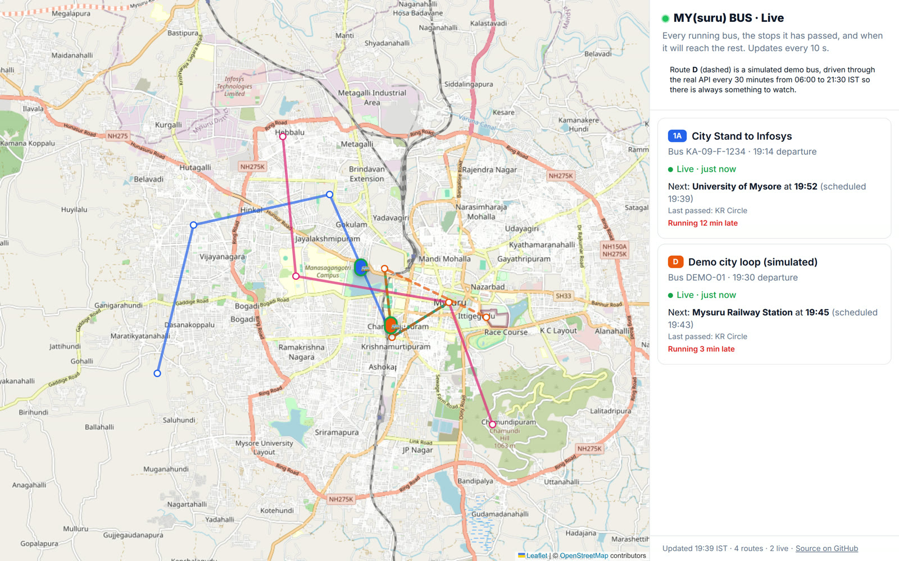
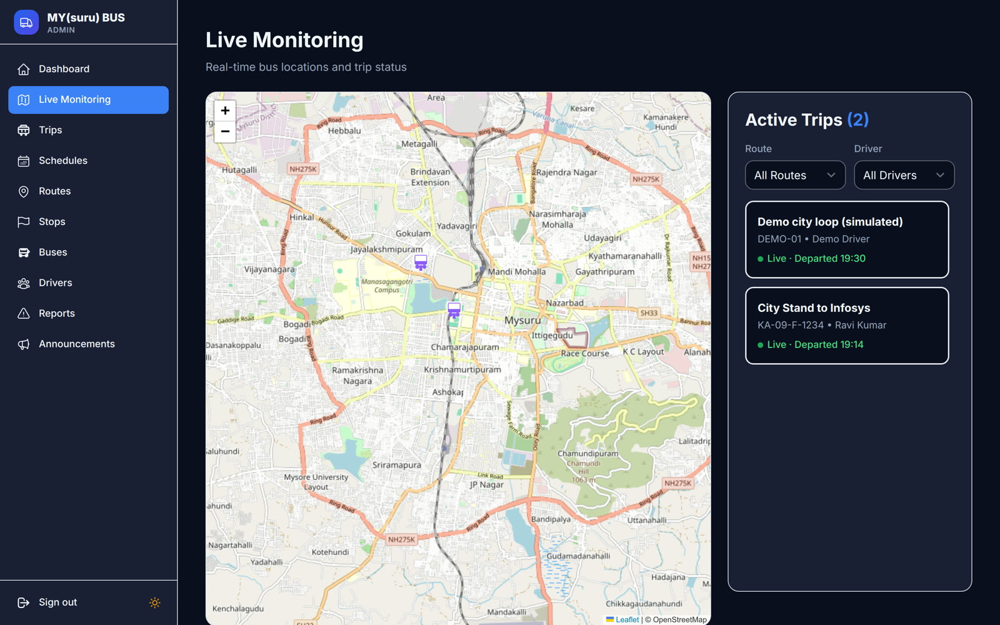
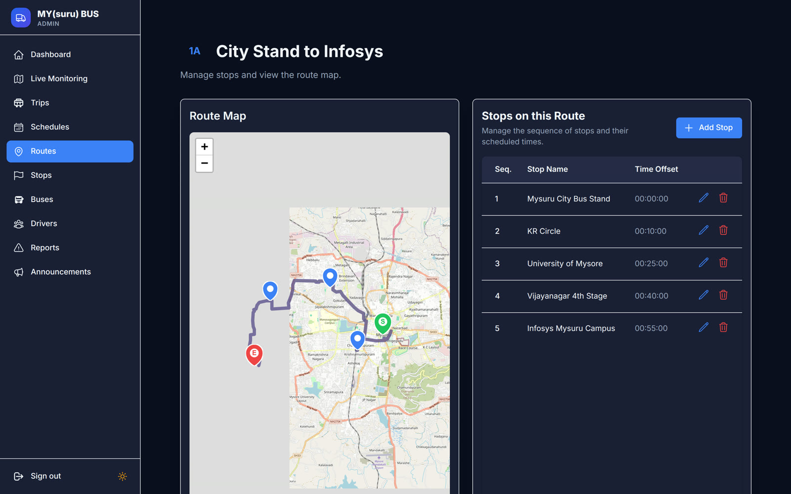
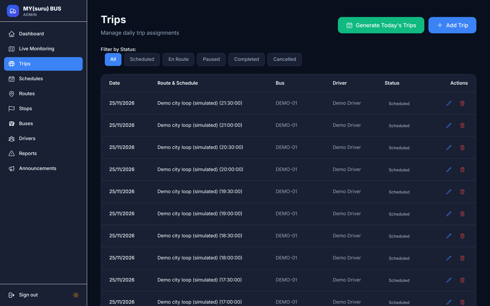
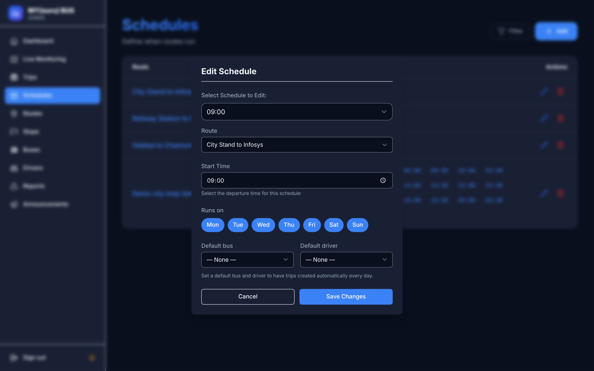
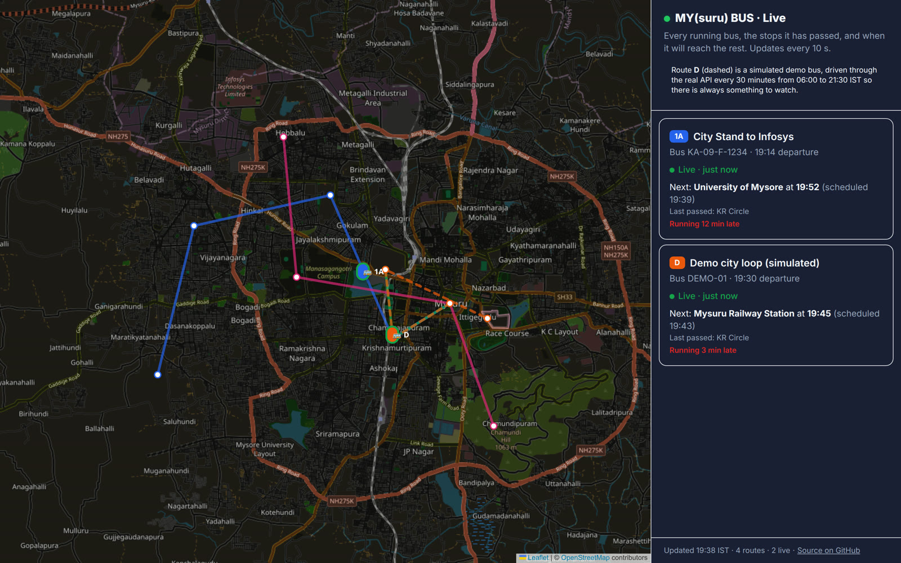
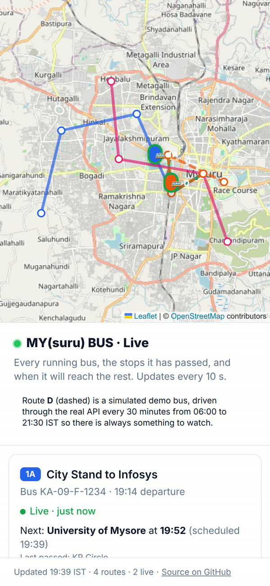

# MY(suru) BUS

[](https://nodejs.org/)
[](https://www.typescriptlang.org/)
[](https://www.postgresql.org/)
[]()

## Real-Time Bus Tracking & Fleet Management System

MY(suru) BUS is a **real-time public transportation management platform** built for Mysuru city — handling live GPS tracking, route management, and passenger information for a city-scale bus network.

Built from scratch as a full-stack, multi-module monorepo with a custom Node.js backend, JWT authentication, and WebSocket real-time updates.

**Live map:** [my-suru-bus.vercel.app/live](https://my-suru-bus.vercel.app/live). No sign-in needed. Route **D** is a simulated demo bus that a GitHub Actions job drives through the real API every 30 minutes, 06:00–21:30 IST, so there is always a bus to watch.



<details>
<summary><b>More screenshots</b></summary>

| | |
|---|---|
|  |  |
| **Admin · Live monitoring**: running and paused trips with how recently each bus reported | **Admin · Route**: stops, time offsets and the route on the map |
|  |  |
| **Admin · Trips**: created automatically each day from the schedules | **Admin · Schedule**: weekdays plus a default bus and driver |
|  |  |
| **Live map · dark theme** | **Live map · phone** |

</details>

---

## System Architecture

```
┌─────────────────────────────────────────────────────────┐
│                    MY(suru) BUS                          │
│                                                         │
│  ┌──────────────┐   ┌──────────────┐                   │
│  │Admin Dashboard│   │  Passenger   │   Web + Mobile     │
│  │  (Next.js)   │   │  App (Expo)  │                   │
│  └──────┬───────┘   └──────┬───────┘                   │
│         │                  │  REST + Socket.io          │
│  ┌──────┴──────────────────┴───────┐                   │
│  │        Backend (Node.js)        │                   │
│  │  Express · JWT · Socket.io      │                   │
│  └──────────────┬──────────────────┘                   │
│                 │                                       │
│  ┌──────────────┴──────────────────┐                   │
│  │  PostgreSQL (Render managed)     │                   │
│  └─────────────────────────────────┘                   │
│                                                         │
│  ┌──────────────┐                                       │
│  │  Driver App  │ ← GPS → Backend → Passenger sockets   │
│  │    (Expo)    │                                       │
│  └──────────────┘                                       │
└─────────────────────────────────────────────────────────┘
```

---

## Modules

| Module | Stack | Description |
|---|---|---|
| [`backend/`](./backend/) | Node.js · Express · PostgreSQL · Socket.io | REST API, JWT auth, real-time GPS broadcasts |
| [`admin-dashboard/`](./admin-dashboard/) | Next.js 14 · TypeScript · Tailwind | Fleet, route, trip, and driver management web app |
| [`driver-app/`](./driver-app/) | React Native · Expo | GPS tracking, trip management, offline sync |
| [`passenger-app/`](./passenger-app/) | React Native · Expo | Route search, live bus map, stop timelines |
| [`website/`](./website/) | HTML · CSS · JS | Marketing and landing page |

---

## Core Features

### Fleet & Operations
- Bus and driver management (admin-only)
- Real-time GPS tracking — foreground and background
- Live trip monitoring on interactive map
- Geofence-based automatic stop detection
- Offline GPS queue with ordered auto-sync (max 50 entries)

### Routes & Schedules
- Route builder with interactive map (Leaflet)
- Stop management with geofence radius configuration
- Schedule creation and bulk trip generation
- Route search by source/destination with GIN trigram indexing

### Real-Time
- Socket.io rooms per bus (`bus-{id}`) and per trip (`trip-{id}`)
- GPS update flow: `Driver REST POST → DB → io.to(room).emit → Passenger`
- Authenticated socket connections — only drivers can emit location data

### Security
- Role-based access: Admin / Driver / Passenger
- JWT authentication (24h expiry) with bcrypt password hashing
- Rate limiting per IP (auth: 10/min, general: 100/min)
- GPS bounds validation, input sanitisation, no raw stack traces in production

---

## Quick Start

### 1. Prerequisites

- Node.js 18+
- npm 9+
- Expo CLI: `npm install -g expo-cli`
- A PostgreSQL database (local or hosted)

### 2. Clone & Install

```bash
git clone https://github.com/ganeshak11/MY-suru-BUS.git
cd MY-suru-BUS

cd backend && npm install && cd ..
cd admin-dashboard && npm install && cd ..
cd driver-app && npm install && cd ..
cd passenger-app && npm install && cd ..
```

### 3. Database Setup

In your PostgreSQL client, run `backend/migrations/000_clean_schema.sql`, then `001_production_hardening.sql`.

Insert your first admin:
```sql
INSERT INTO public.admins (name, email, password_hash)
VALUES ('Admin', 'admin@yourbus.com', '<bcrypt hash of your password>');
```
Generate the hash: `node -e "require('bcryptjs').hash('YourPass',12).then(console.log)"`

### 4. Configure Environment

```bash
# backend/.env
DATABASE_URL=postgresql://...  # your PostgreSQL connection string
DATABASE_SSL=true
JWT_SECRET=your_strong_random_secret
PORT=3001
NODE_ENV=development
ALLOWED_ORIGINS=http://localhost:3000,exp://localhost:19000

# admin-dashboard/.env.local
NEXT_PUBLIC_API_URL=http://localhost:3001/api
```

Driver and passenger apps auto-detect the backend host in development via Expo Constants (no `.env` needed).

### 5. Run

```bash
# Terminal 1 — Backend
cd backend && npm run dev

# Terminal 2 — Admin Dashboard
cd admin-dashboard && npm run dev   # http://localhost:3000

# Terminal 3 — Driver App
cd driver-app && npx expo start

# Terminal 4 — Passenger App
cd passenger-app && npx expo start
```

---

## Project Structure

```
MY-suru-BUS/
├── backend/              # Node.js REST API + Socket.io
├── admin-dashboard/      # Next.js web dashboard
├── driver-app/           # Expo driver mobile app
├── passenger-app/        # Expo passenger mobile app
├── website/              # Marketing landing page
├── Assets/               # Shared logos and assets
├── Docs/                 # Project documentation
└── README.md
```

---

## Current Status

- ✅ **Backend**: server-side trip progress and ETAs (schedule + live delay), automatic daily trips, 68 tests
- ✅ **Admin Dashboard**: Next.js 15; trips, schedules, routes, drivers, live monitoring; public `/live` map
- ✅ **Driver App**: background GPS with offline queue, sessions that renew mid-shift
- ✅ **Passenger App**: route search, live buses with stops passed, ETAs and delay
- ✅ **Builds**: Android APKs built on GitHub Actions ([Docs/ANDROID_BUILDS.md](Docs/ANDROID_BUILDS.md))
- 📄 **Audits**: [code](Docs/AUDIT_2026-11.md) and [implementation](Docs/IMPLEMENTATION_AUDIT_2026-11.md)

---

## License

Built for academic and portfolio use (Mini Project).

---

## Contact

- **Email:** ganeshangadi13012006@gmail.com
- **GitHub Issues:** [Create an issue](https://github.com/ganeshak11/MY-suru-BUS/issues)
